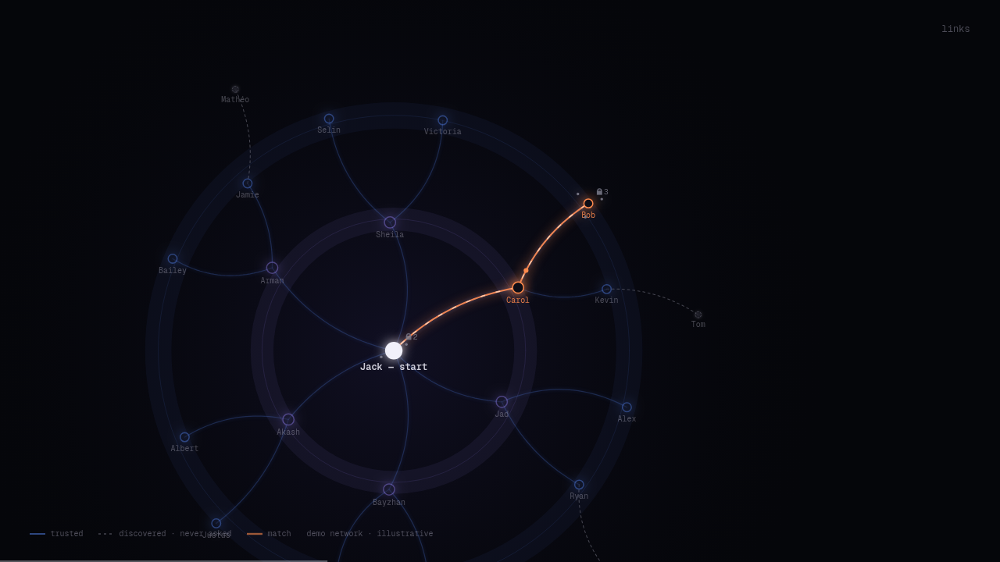

# Asymmetry: shareable demo

`/demo` is a continuous, full-screen network animation (about 17 seconds) that
shows what Asymmetry does: one person's agent asks its trusted friends' agents,
the request ripples out, and a match two hops away comes back through a friend.
It runs entirely in the browser: no backend, no database, no OpenAI key.

## Run it (one command)

From a fresh clone, on Node `^22.12 || ^24 || >=26` and npm `>=10`:

```bash
npm install && npm run demo
```

Then open **http://localhost:3000/demo**.

`npm run demo` builds `@asymmetry/shared` and starts the existing Next.js app in
`apps/web` with `NEXT_PUBLIC_SOCKET_MODE=mock` on port 3000. The rest of the app
(`/login`, `/tasks`, `/network`) also runs in mock mode, replaying the seeded
Alice ↔ Bob negotiation from `lib/mock.ts`.

- It autoplays once. Click or press space to pause, click at the end (or press `r`) to replay.
- `/demo?t=6` freezes the animation at 6 seconds (handy for screenshots).
- `links` (top right) opens links and credits.
- With `prefers-reduced-motion`, it shows a single still frame.

## Recording and screenshots

- Recording (0:20, 1280×720 mp4): [`demo-assets/asymmetry-demo.mp4`](demo-assets/asymmetry-demo.mp4)
  ([direct download](https://github.com/thejackluo/asymmetry/raw/demo/linkedin-shareable-demo/docs/demo-assets/asymmetry-demo.mp4))
- Frames and the links overlay: [`demo-assets/`](demo-assets/)



## What it shows

The housing story is the seeded one in `apps/server/src/seed.ts` (Alice wants a
summer sublet near Georgia Tech, May–Aug, under $1200/mo; Bob has a furnished room
0.4mi from campus, $950/mo, May 15–Aug 10), retold with **Jack** as the requester. There are no slides and almost no text:
the story is told by the graph.

1. **Ask.** Jack's node glows. Three blue dots (the in-scope request:
   `location_area`, `price`, `dates`) orbit him; two grey dots and a lock with a
   `2` (his private facts) stay put.
2. **Ripple.** The camera pulls back as curved edges draw out to his 6 trusted
   friends, then their 12 friends. Nodes bloom in as the request arrives and
   spring into place (d3-force). 4 more agents are seen along dashed grey edges
   but are **never asked**.
3. **Match.** The camera glides (d3 `interpolateZoom`) to Jack → Carol → Bob as
   the path turns orange. Bob's 3 in-scope facts travel back through Carol;
   his other 3 stay orbiting him behind a lock with a `3`.
4. **Intro.** Carol pulses and reaches both sides at once: the intro goes
   through the trusted connection.
5. **Everyone.** Coloured searches start from other people's agents across the
   same network, then `asymmetry.` / *let the agents talk*.

### The graph (demo-only)

23 nodes: `Jack — start`, 6 trusted hop-1 friends, 12 hop-2 friends of friends,
and 4 discovered agents. Trusted edges are solid blue, discovered edges are dashed
grey, and the match path Jack → Carol → Bob is highlighted in orange. Discovered
nodes appear as the search spreads. Names are first names only and illustrative.

The network and timeline live in `apps/web/lib/demo-network.ts` and are drawn on a canvas by
`apps/web/components/DemoCanvas.tsx`. It is illustrative only. It
is not seed data and is never written to the database. `seed.ts` and
`CONTRACTS.md` are unchanged.

### Privacy invariants

- Private facts never go to a peer. Peers see withheld **counts**, never content.
- Bob's private facts (his exact address and phone) are never displayed, logged
  or stored in the demo. `lib/demo-network.test.ts` reads `seed.ts` at test time
  and fails if any of Bob's private fact text appears in the demo code or docs.

## Verify

```bash
npm run lint -w @asymmetry/web
npm run typecheck -w @asymmetry/web   # run after `npm run demo` or `npm run build -w @asymmetry/web` (generates Next route types)
npm test -w @asymmetry/web
```

## Links

- Asymmetry repo: https://github.com/thejackluo/asymmetry
- Asymmetry demo video: https://www.youtube.com/watch?v=7YhwRBV33PU
- HackerHouse project page (2nd place): https://www.gthackerhouse.com/events/devin-hackathon/projects/481d499f-9e34-4b73-8805-a96aa4eea89d
- Devin session (as listed on HackerHouse): https://app.devin.ai/sessions/3f6ed8da12944a3294f4ed4deb971c95
- LinkedIn shared post: https://www.linkedin.com/feed/update/urn:li:activity:7520388543140143104/
- LinkedIn original post by Bayzhan: https://www.linkedin.com/posts/bayzhan8_yesterday-we-got-2nd-place-at-the-cognition-ugcPost-7520259507004997632-pvH1/
- Jack on LinkedIn: https://www.linkedin.com/in/thejackluo/
- Jad (activity): https://www.linkedin.com/in/jad-matthew-bardawil/recent-activity/all/
- Akash (activity): https://www.linkedin.com/in/akash-si/recent-activity/all/
- HackerHouse Devin Hackathon projects: https://www.gthackerhouse.com/events/devin-hackathon/projects
- Event page (Luma): https://luma.com/7my0pg5g
- HackerHouse @ Georgia Tech: https://gthackerhouse.com/
- HackerHouse on LinkedIn: https://www.linkedin.com/company/gt-hackerhouse/
- HackerHouse on X: https://x.com/gthackerhouse
- HackerHouse Campus: https://hackerhousecampus.com

## Credits

Built at the Devin Hackathon at HackerHouse @ Georgia Tech (2nd place) by
Jack Luo ([@thejackluo](https://github.com/thejackluo)), Bayzhan
([@bayzhan8](https://github.com/bayzhan8)), Jad ([@jmb245](https://github.com/jmb245))
and Akash ([@AkashSingirikonda](https://github.com/AkashSingirikonda)), with four
Devins working in parallel.
